<p align="center">
  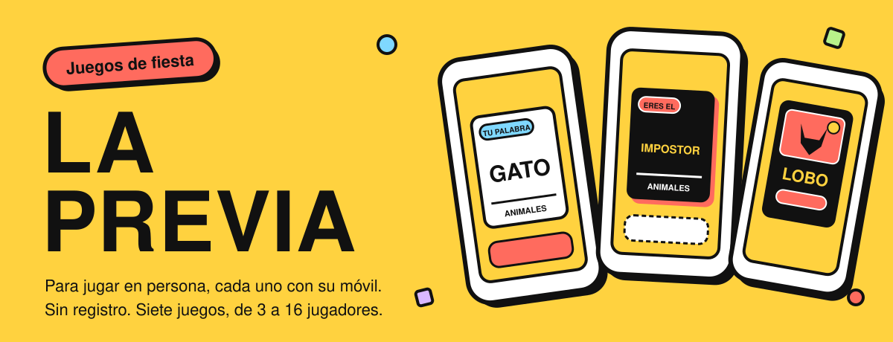
</p>

# La Previa

Web gratuita de juegos de fiesta para jugar **en persona**, cada uno con su móvil. Sin registro y sin instalar nada: alguien crea una sala, los demás entran con un código de cuatro letras, un enlace o un QR, y el móvil reparte la información secreta y lleva la cuenta mientras el juego ocurre hablando.

Trae **siete juegos**. Seis son de 3 a 16 jugadores; El lobo, de 4 a 16.

| Juego                                                      | Jugadores | En una frase                                                                      |
| ---------------------------------------------------------- | --------- | --------------------------------------------------------------------------------- |
| [El lobo](#el-lobo)                                        | 4–16      | Un pueblo con lobos escondidos. De noche matan; de día se ahorca a un sospechoso. |
| [El impostor](#el-impostor)                                | 3–16      | Todos conocen la palabra menos uno. Descubrid quién disimula.                     |
| [¿Quién es más probable que…?](#quién-es-más-probable-que) | 3–16      | Sale una pregunta y todos señaláis a alguien a la vez.                            |
| [¿Quién lo dijo?](#quién-lo-dijo)                          | 3–16      | Todos escribís una respuesta y adivináis de quién es la que sale.                 |
| [Una sola pista](#una-sola-pista)                          | 3–16      | Uno adivina la palabra con una pista de cada uno. Las repetidas no valen.         |
| [¿Qué prefieres?](#qué-prefieres)                          | 3–16      | Sale un dilema, cada uno elige en secreto y puntúa quien piensa como la mayoría.  |
| [Palabras prohibidas](#palabras-prohibidas)                | 3–16      | Uno describe una palabra sin decir las cinco prohibidas. Los demás adivinan.      |

## Índice

- [Cómo se juega una noche](#cómo-se-juega-una-noche)
- [La sala](#la-sala)
- [Los juegos](#los-juegos)
- [Pensada para una fiesta de verdad](#pensada-para-una-fiesta-de-verdad)
- [Cómo funciona por dentro](#cómo-funciona-por-dentro)
- [Pruebas](#pruebas)
- [Arrancar en local](#arrancar-en-local)
- [Scripts](#scripts)
- [Estructura](#estructura)
- [Documentación](#documentación)
- [Reglas del repositorio](#reglas-del-repositorio)

## Cómo se juega una noche

<p align="center">
  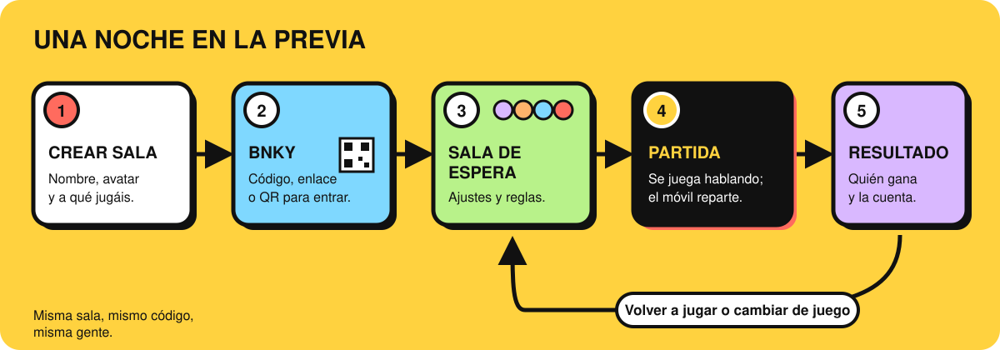
</p>

1. **Crear sala.** Quien organiza pone su nombre, elige avatar y escoge a qué se juega.
2. **Compartir.** La sala tiene un código de cuatro letras (sin I, L ni O, para que no se confundan). Los demás lo escriben en el inicio, abren el enlace `/sala/CODIGO` o escanean el QR desde el botón **Escanear QR** del inicio.
3. **Sala de espera.** Cada uno ve quién ha entrado. El anfitrión ajusta la partida y cualquiera puede abrir **Cómo se juega**, que explica el juego en unos pocos pasos ilustrados.
4. **Partida.** El anfitrión avanza las fases. El resto pasa hablando: el móvil solo enseña lo que a cada uno le toca saber.
5. **Resultado.** Quién gana y, en los juegos por rondas, la clasificación. Desde ahí se vuelve a jugar o se cambia de juego **sin salir de la sala**: mismo código, misma gente.

## La sala

<table>
  <tr>
    <td align="center" width="25%">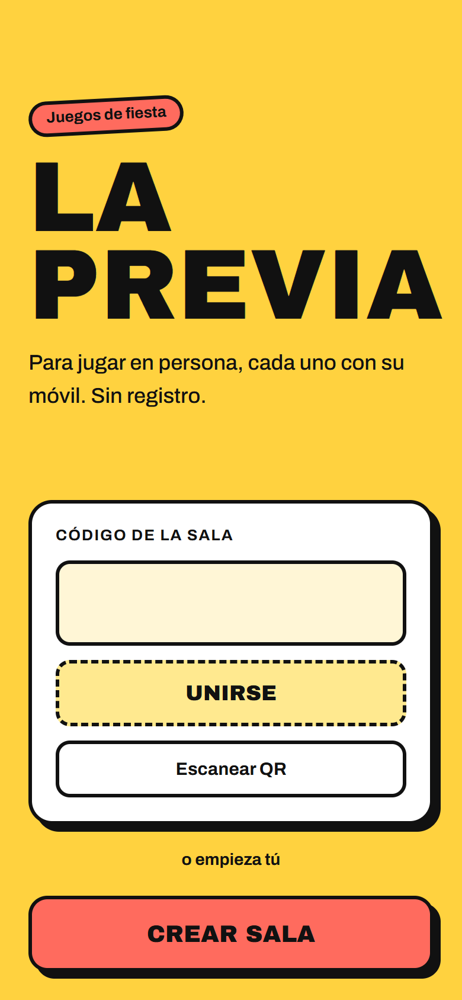<br><sub><b>Inicio.</b> Unirse con código o QR, o crear sala.</sub></td>
    <td align="center" width="25%">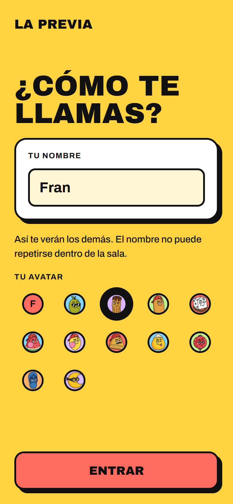<br><sub><b>Nombre y avatar.</b> Once avatares o tu inicial.</sub></td>
    <td align="center" width="25%">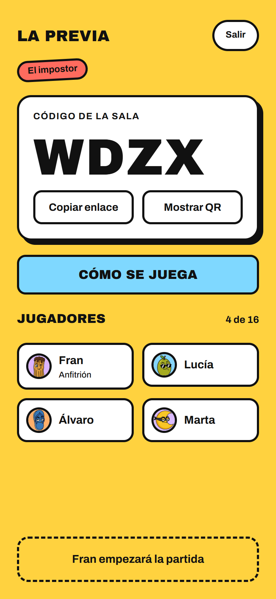<br><sub><b>Sala de espera.</b> El invitado ve quién está y quién empezará.</sub></td>
    <td align="center" width="25%">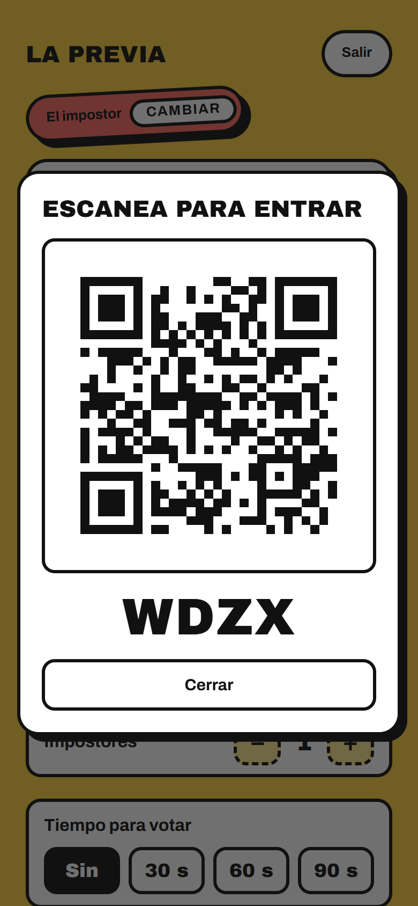<br><sub><b>QR.</b> Para entrar apuntando con la cámara.</sub></td>
  </tr>
</table>

<table>
  <tr>
    <td align="center" width="33%">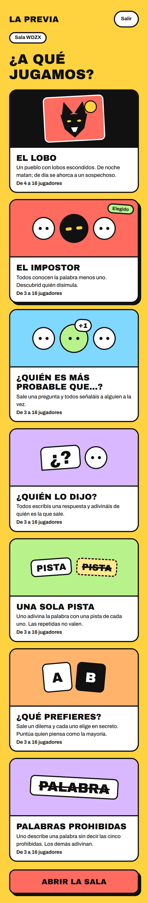<br><sub><b>Selector.</b> Los siete juegos, cada uno con su ilustración.</sub></td>
    <td align="center" width="33%">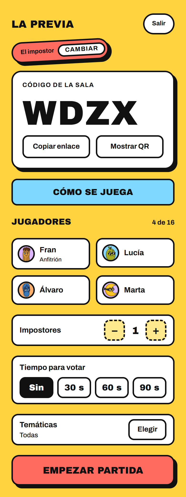<br><sub><b>Anfitrión.</b> Código, jugadores y ajustes del juego. La píldora de arriba cambia de juego.</sub></td>
    <td align="center" width="33%">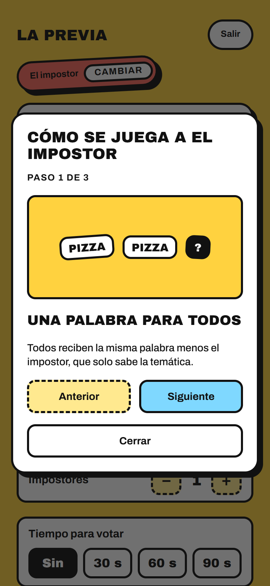<br><sub><b>Cómo se juega.</b> Las reglas en pasos ilustrados.</sub></td>
  </tr>
</table>

Lo que puede hacer el anfitrión:

- **Elegir y cambiar el juego.** Antes de abrir la sala, y después desde la píldora con el nombre del juego en la sala de espera o desde el resultado.
- **Ajustar la partida.** Número de rondas en los juegos por rondas; impostores, temáticas y tiempo para votar en El impostor; lobos y roles en El lobo.
- **Expulsar.** En la sala de espera, a cualquiera; durante la partida, solo a quien se ha desconectado.

En una sala caben hasta **16 jugadores**. Los nombres tienen de 1 a 14 caracteres y no se repiten dentro de la sala.

## Los juegos

Cinco juegos son **por rondas** (5, 10 o 15, a elegir): ¿Quién es más probable que…?, ¿Quién lo dijo?, Una sola pista, ¿Qué prefieres? y Palabras prohibidas. Comparten la forma de jugar: cuando han respondido todos se pasa solo a la revelación, quien lleva la fase puede cerrarla si alguien tarda, y los puntos se ven durante toda la partida. Quien entra tarde se incorpora en la siguiente ronda. El contenido no se repite en la misma sala mientras queden opciones.

### El lobo

<table>
  <tr>
    <td align="center" width="25%">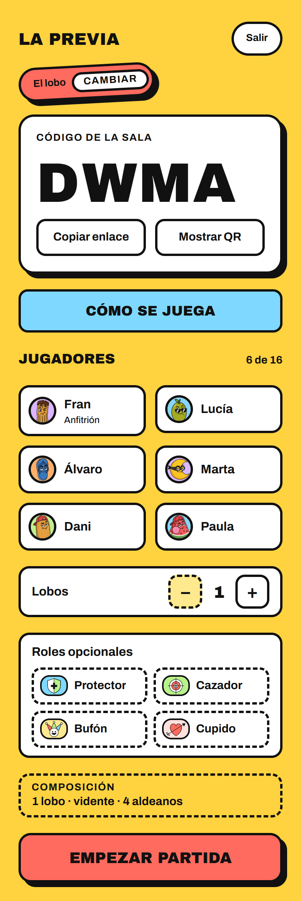<br><sub><b>Reparto.</b> Por defecto, el recomendado para los que sois.</sub></td>
    <td align="center" width="25%">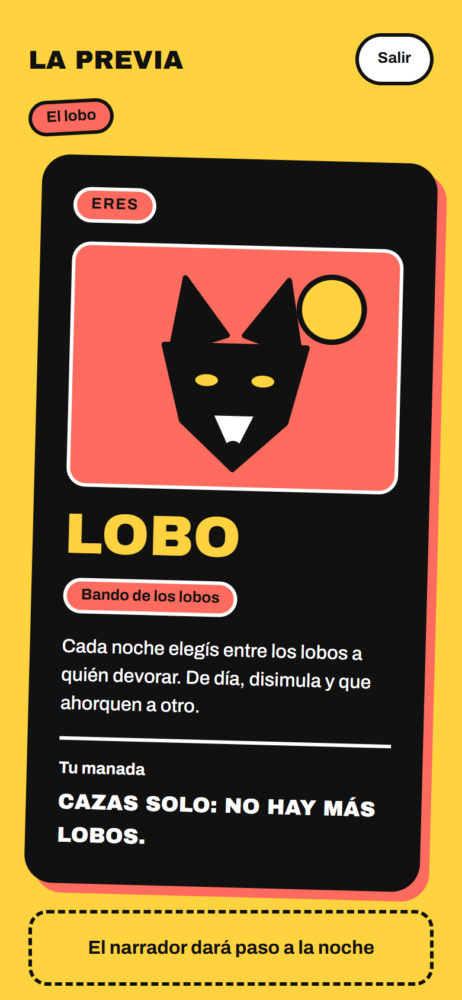<br><sub><b>Tu carta.</b> El lobo ve también a su manada.</sub></td>
    <td align="center" width="25%">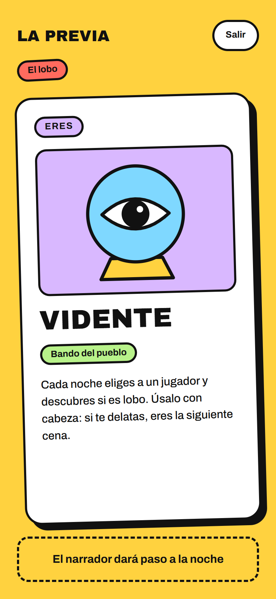<br><sub><b>Roles.</b> Cada uno con su ilustración y su efecto.</sub></td>
    <td align="center" width="25%">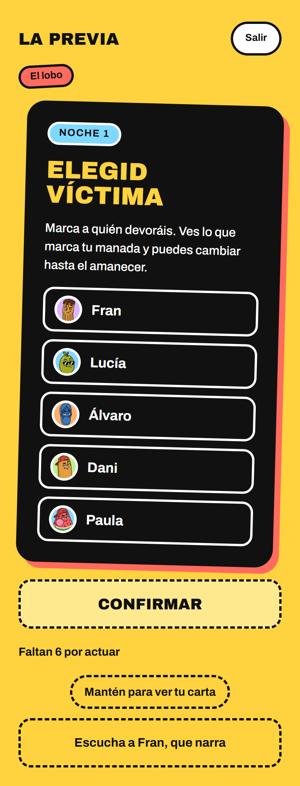<br><sub><b>Noche.</b> Los lobos eligen víctima y ven lo que marca su manada.</sub></td>
  </tr>
</table>

Un pueblo con lobos escondidos. El anfitrión hace de **narrador** y además juega: su pantalla le marca qué leer en voz alta y cuándo avanzar.

- **Noche.** Todos tocan el móvil a la vez, para que nadie se delate por ser el único que lo usa. Los lobos eligen a quién devorar; el asesino, a quién matar; la vidente descubre si alguien es lobo; el protector salva a uno; la bruja ve a quién van a devorar y decide si gasta sus pociones; los demás marcan de quién sospechan.
- **Día.** Se anuncia quién ha muerto, sin decir cómo: para los vivos, "ha muerto esta noche". Si no hay alcalde vivo, se elige uno (su voto vale doble). El pueblo debate con los móviles boca abajo, vota a quién acusar, el acusado tiene sus últimas palabras y se le ahorca.
- **Roles.** Lobos y aldeanos, y como mucho uno de cada especial: **vidente**, **protector** (no puede proteger a la misma persona dos noches seguidas), **cazador** (al morir se lleva a alguien), **bufón** (gana él solo si el pueblo lo ahorca), **Cupido** (une a dos enamorados que mueren juntos), **bruja** (una poción de vida y otra de muerte, de un solo uso cada una en toda la partida) y **asesino** (juega solo y mata cada noche).
- **Victoria.** El asesino gana si queda solo. Mientras siga vivo, nadie más gana. Sin él, el pueblo gana si no quedan lobos y los lobos, si igualan en número al resto. El bufón, si lo ahorcan.
- **Composición libre.** El anfitrión elige cuántos lobos y qué roles. Solo se impide lo que no se puede jugar (sin lobos ni asesino, todos lobos o más roles que jugadores); si está desequilibrada, la sala lo avisa sin bloquear. El reparto recomendado sigue a un toque: hasta 6 jugadores, 1 lobo y la vidente; de 7 a 8, 2 lobos y protector; de 9 a 11, se suma el cazador; de 12 a 13, 3 lobos y el bufón; desde 14, también Cupido.

<table>
  <tr>
    <td align="center" width="50%">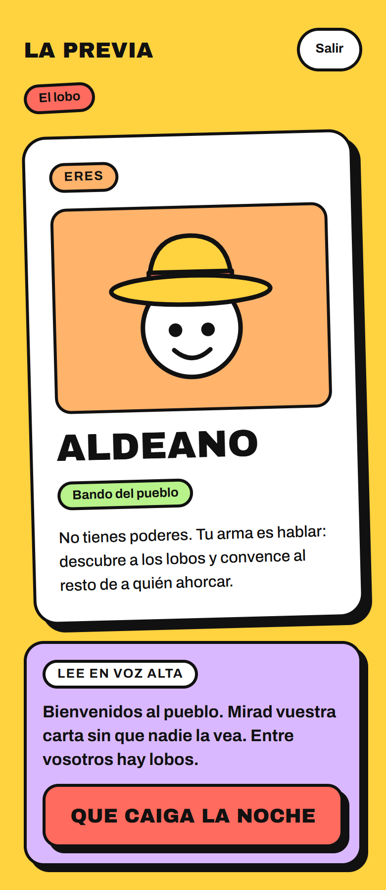<br><sub><b>El narrador</b> ve su carta y el guion: «Bienvenidos al pueblo…».</sub></td>
    <td align="center" width="50%">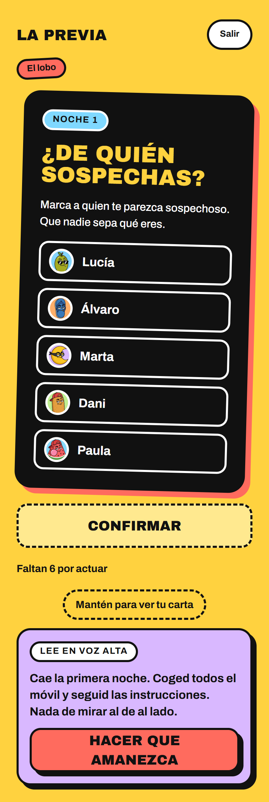<br><sub><b>Su noche.</b> Juega como uno más y lleva el ritmo con el botón del guion.</sub></td>
  </tr>
</table>

### El impostor

<table>
  <tr>
    <td align="center" width="33%">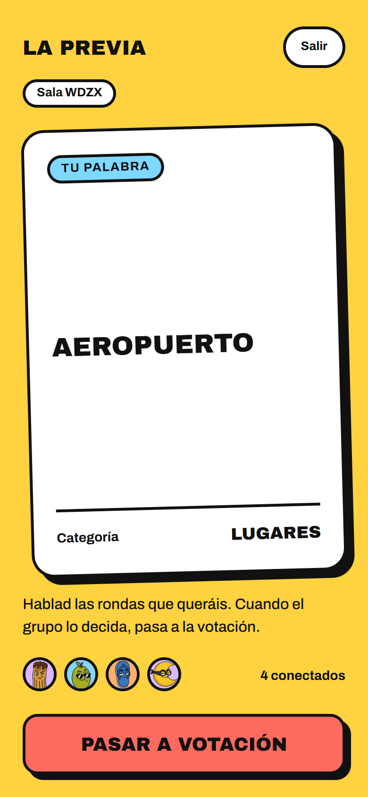<br><sub>Los jugadores ven la palabra.</sub></td>
    <td align="center" width="33%">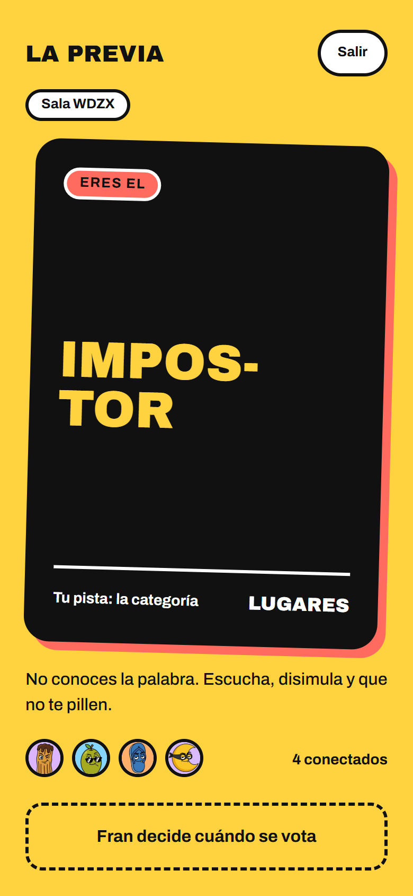<br><sub>El impostor, solo la categoría.</sub></td>
    <td align="center" width="33%">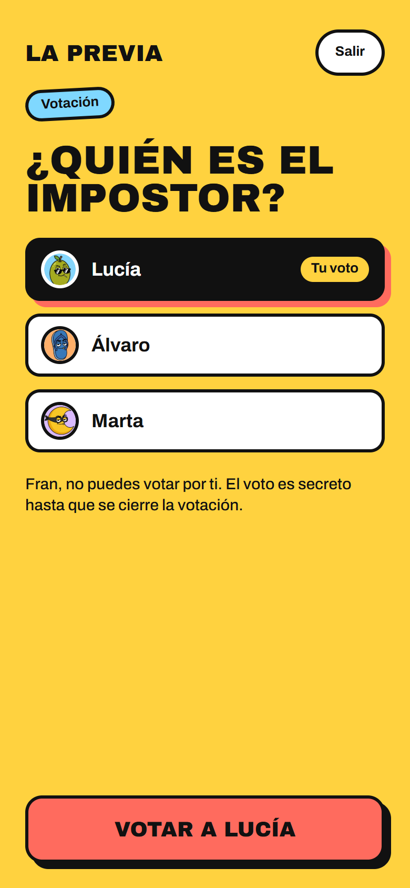<br><sub>Votación secreta hasta el cierre.</sub></td>
  </tr>
</table>

Todos reciben la misma palabra menos el impostor, que solo sabe la categoría y tiene que disimular. El grupo habla las rondas que quiera y, cuando lo decide, el anfitrión abre la votación.

- Nadie puede votarse a sí mismo y el voto no se cambia. Se ve **quién** ha votado, nunca a quién.
- El más votado queda eliminado y se revela si era impostor. Con empate no sale nadie.
- Gana el grupo si no quedan impostores; ganan los impostores si igualan en número a los demás.
- **Ajustes:** número de impostores (siempre menos de la mitad), temáticas (300 palabras en 15 temáticas) y tiempo para votar (sin límite, 30, 60 o 90 segundos).

### ¿Quién es más probable que…?

<table>
  <tr>
    <td align="center" width="50%">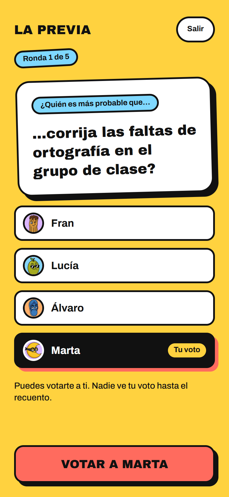<br><sub>Todos votan a la vez. Vale votarse.</sub></td>
    <td align="center" width="50%">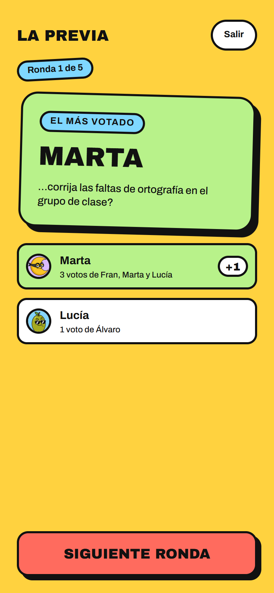<br><sub>El recuento dice quién votó a quién.</sub></td>
  </tr>
</table>

Sale una pregunta («…acabe conociendo a todos los invitados de una boda?») y cada uno señala a alguien. El más votado se lleva el punto; con empate en cabeza, lo recibe cada empatado. Al final, el que más puntos tiene es «el más probable de la noche».

### ¿Quién lo dijo?

<p align="center">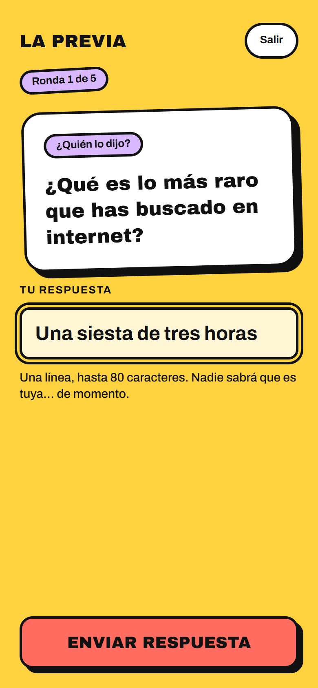</p>

Sale una pregunta y todos escriben una respuesta corta. El servidor elige una, sin autor, rotando para que el protagonismo se reparta. Los demás votan de quién es: **1 punto** por acertar, y el autor se lleva 1 por cada uno que falla.

### Una sola pista

<p align="center">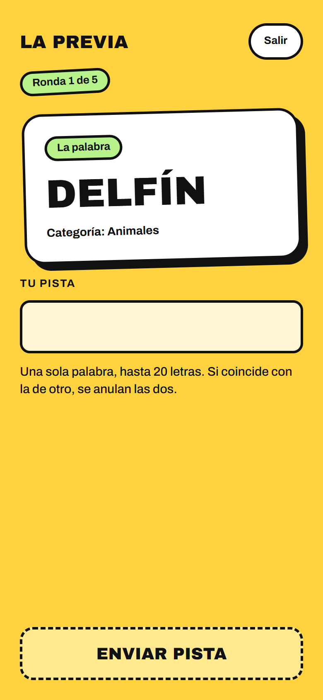</p>

Cooperativo. Uno adivina; los demás ven la palabra y escriben **una pista de una sola palabra**. Las pistas repetidas se anulan solas, y los que dan pista pueden anular a mano las que el automático no ve («perro» y «perros»). El adivino ve las que sobreviven y responde en voz alta; un árbitro marca si ha acertado. El marcador es del equipo: un punto por palabra acertada. Quien adivina no recibe la palabra hasta el final, ni siquiera por la red.

### ¿Qué prefieres?

<p align="center">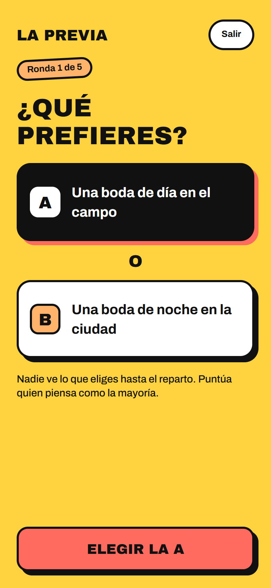</p>

Sale un dilema con dos opciones y cada uno elige en secreto. Puntúa quien coincide con **la mayoría**; con empate no puntúa nadie. Al final, quien más puntos tiene es «quien mejor conoce al grupo». Hay 120 dilemas.

### Palabras prohibidas

<p align="center">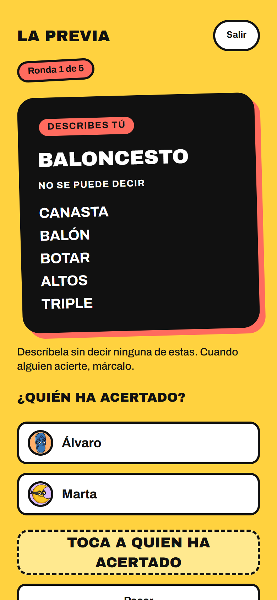</p>

Uno describe una palabra sin decir ninguna de las cinco prohibidas. Otro **vigila** con la misma tarjeta y pulsa «¡Prohibida!» si se le escapa una. Los demás adivinan en voz alta. Cuando alguien acierta, quien describe lo toca en la lista y se llevan un punto cada uno. Hay 150 tarjetas; quien adivina no recibe la tarjeta hasta la revelación.

## Pensada para una fiesta de verdad

En una fiesta, los móviles se bloquean, cambian de wifi a datos y alguien abre WhatsApp a mitad de ronda. Eso es lo normal, no la excepción:

- **Nada se pierde al salir y volver.** La pantalla se reconstruye entera con el estado del servidor. Un móvil que se bloquea o cambia de red vuelve a su sitio.
- **La pantalla no se apaga** mientras estás en una sala (Screen Wake Lock, si el navegador lo permite).
- **Si el anfitrión desaparece** 90 segundos, pasa a serlo el jugador conectado más antiguo. En El lobo, el narrador también se traspasa.
- **La partida sigue** si alguien se desconecta. Aparece como desconectado y puede volver.
- **Quien llega tarde** entra en la sala y juega en la siguiente partida o ronda.
- **Nada de trampas.** Ver el apartado siguiente.

## Cómo funciona por dentro

<p align="center">
  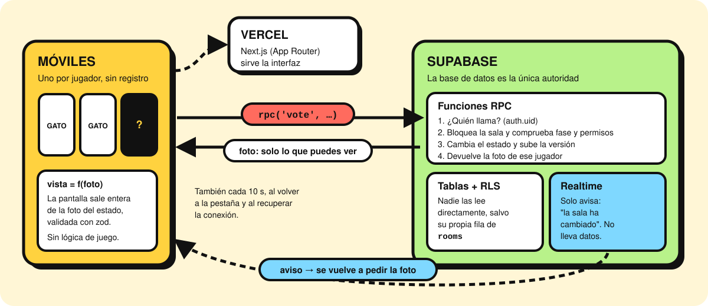
</p>

- **Next.js** (App Router, TypeScript estricto) para la interfaz, desplegada en **Vercel**.
- **Supabase**: Postgres, inicio de sesión anónimo y Realtime. Cada móvil tiene una sesión anónima; no hay cuentas.
- **La base de datos es la única autoridad.** Los móviles no leen ni escriben tablas. Llaman a funciones RPC que comprueban quién llama, bloquean la sala, verifican que la fase y los permisos lo permiten, cambian el estado y devuelven una **foto del estado** con solo lo que ese jugador puede ver.
- **La pantalla se deduce de la foto** con una función pura. No hay fase guardada en el cliente ni navegación por fases: si llega la foto, llega la pantalla.
- **Sincronización.** Realtime solo avisa de que la sala ha cambiado, sin datos, y el móvil vuelve a pedir su foto. Además la pide cada 10 segundos, al volver a la pestaña y al recuperar la conexión. Una foto más antigua que la que ya hay se descarta.

### El secreto se queda en el servidor

<p align="center">
  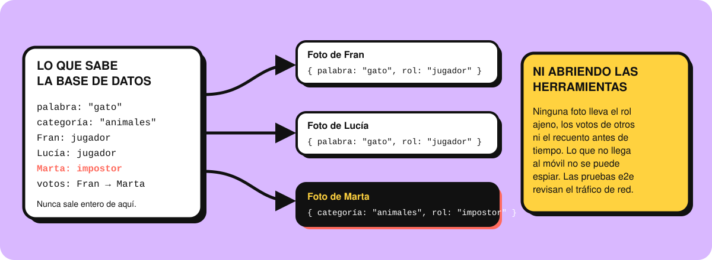
</p>

Como cada foto se calcula para quien la pide, abrir las herramientas del navegador no sirve de nada: no se puede averiguar al impostor, ver votos ajenos o el recuento antes de tiempo, saber de quién es una respuesta, ver la palabra si te toca adivinar ni, en El lobo, el rol de nadie vivo, las pociones de la bruja, a quién va el asesino o cómo ha muerto alguien de noche. Las pruebas pgTAP y las e2e lo comprueban leyendo lo que llega por la red. (La foto real es un JSON validado con `zod` en `src/lib/snapshot.ts`; el dibujo la simplifica.)

## Pruebas

| Tipo                       | Dónde                                            | Qué cubre                                                                                                                 |
| -------------------------- | ------------------------------------------------ | ------------------------------------------------------------------------------------------------------------------------- |
| Unitarias y de componentes | `src/**/*.test.ts(x)` (Vitest + Testing Library) | Funciones de vista, contrato de la foto, acciones, componentes y pantallas                                                |
| Base de datos              | `supabase/tests` (pgTAP)                         | Cada función RPC, sus rechazos y lo que **no** debe salir en la foto                                                      |
| Extremo a extremo          | `e2e` (Playwright)                               | Partidas completas con varios "móviles", reconexión, entrar tarde, secreto por la red y accesibilidad a 360, 390 y 430 px |

Las capturas de este README salen de partidas reales en el entorno local, a 390 px de ancho.

## Arrancar en local

Requisitos: Node 20.9 o posterior (LTS), npm y Docker Desktop en marcha.

```bash
npm install
git config core.hooksPath .githooks   # una vez por clon: activa el gancho de commits
npx @ericrisco/rsc sync               # una vez por clon: instala las skills y ganchos del harness
npx supabase start                    # base de datos local en Docker
npx supabase status -o env            # muestra API_URL y ANON_KEY
```

Crea `.env.local` a partir de [`.env.example`](.env.example) con esos dos valores:

```bash
NEXT_PUBLIC_SUPABASE_URL=http://127.0.0.1:54321
NEXT_PUBLIC_SUPABASE_ANON_KEY=…
```

Y arranca la aplicación:

```bash
npm run dev
```

Abre `http://localhost:3000`. Para jugar en local con varios "móviles", usa ventanas de incógnito o navegadores distintos: cada uno es un jugador. La página `/dev/componentes` muestra todos los componentes (no existe en producción).

Para publicarla en Supabase y Vercel, sigue [`docs/DESPLIEGUE.md`](docs/DESPLIEGUE.md).

## Scripts

| Script                        | Qué hace                                                                                                                   |
| ----------------------------- | -------------------------------------------------------------------------------------------------------------------------- |
| `npm run dev`                 | Aplicación en desarrollo.                                                                                                  |
| `npm run build` / `npm start` | Compilación y servidor de producción.                                                                                      |
| `npm run check`               | Lint, tipos y tests unitarios. Es lo que tiene que pasar antes de cada commit.                                             |
| `npm run lint`                | ESLint sin avisos permitidos.                                                                                              |
| `npm run typecheck`           | Genera los tipos de Next y comprueba TypeScript.                                                                           |
| `npm test`                    | Tests unitarios y de componentes (Vitest).                                                                                 |
| `npm run test:db`             | Pruebas pgTAP de la base de datos. Necesita `npx supabase start`; para partir de cero, antes `npx supabase db reset`.      |
| `npm run test:e2e`            | Pruebas de extremo a extremo con Playwright contra el entorno local. Arrancan `next dev` solas y usan el Chrome instalado. |
| `npm run format`              | Formatea con Prettier.                                                                                                     |

## Estructura

```
src/
  app/             Rutas de Next: / (inicio) y /sala/[code]; Room elige el juego por game.type
  games/           Una carpeta por juego; ninguna importa de la carpeta de otro juego
    impostor/        El impostor: qué pantalla toca (view.ts, función pura), datos y pantallas
    probable/        ¿Quién es más probable que…?
    quien-lo-dijo/   ¿Quién lo dijo?
    una-pista/       Una sola pista
    que-prefieres/   ¿Qué prefieres?
    palabras-prohibidas/  Palabras prohibidas
    luna-llena/      El lobo (Luna llena en el código): roles, cartas e ilustraciones,
                       composición, guion del narrador y pantallas de cada fase
    rounds/          Lo que comparten los juegos por rondas: espera de respuestas, lista para
                       votar, resultado con clasificación y controles de quien lleva la fase
  screens/         Pantallas de la plataforma (inicio, nombre, selector, sala de espera, entrar
                     tarde) y diálogos: solo presentación
  components/      Componentes base de Verbena (botón, tarjeta, píldora, avatar…)
  lib/             Lógica del cliente sin interfaz:
                     snapshot.ts   contrato de la foto del estado, validado con zod
                     actions.ts    una función por RPC y traducción de errores
                     sync.ts, use-room-sync.ts   sincronización (Realtime, sondeo, reintentos)
                     copy.ts       todos los textos de la interfaz
                     scan.ts, qr-camera.ts   leer el QR de una sala con la cámara
                     use-countdown.ts        cuenta atrás de la votación con la hora del servidor
                     avatars.ts    la galería de avatares (las imágenes, en public/avatars/)
  test/            Datos de ejemplo para los tests
supabase/
  migrations/      Esquema, seguridad (RLS), funciones, palabras, preguntas y tarjetas. Nunca se editan: se
                     añaden nuevas. Las funciones de cada juego llevan su prefijo
                     (probable_, quien_lo_dijo_, una_pista_, que_prefieres_,
                     palabras_prohibidas_, luna_llena_; las auxiliares de Luna llena,
                     luna_); lo común de los juegos por rondas
                     vive en el esquema private (open_round, round_departure, round_state,
                     next_subject…)
  tests/           Pruebas pgTAP, incluidas las de secreto de cada juego
e2e/               Pruebas de Playwright
docs/              Contexto, juegos, planes, decisiones, contenido, despliegue e informe
  img/             Capturas e ilustraciones de este README
public/avatars/    Imágenes de los avatares
```

## Documentación

- **Qué se construye y por qué:** [`docs/CONTEXTO.md`](docs/CONTEXTO.md) (plataforma y El impostor), [`docs/JUEGOS.md`](docs/JUEGOS.md) (¿Quién es más probable que…?, ¿Quién lo dijo? y Una sola pista), [`docs/JUEGOS-2.md`](docs/JUEGOS-2.md) (¿Qué prefieres? y Palabras prohibidas), [`docs/MEJORAS.md`](docs/MEJORAS.md) (lo que se añadió tras probarla en grupo) y [`docs/PLAN-5.md`](docs/PLAN-5.md) (El lobo, con las ilustraciones de sus cartas).
- **En qué orden se hizo:** [`docs/PLAN.md`](docs/PLAN.md) a [`docs/PLAN-5.md`](docs/PLAN-5.md), con el estado en [`docs/TAREAS.md`](docs/TAREAS.md).
- **Contenido para revisar:** [`docs/PALABRAS.md`](docs/PALABRAS.md), [`docs/PREGUNTAS.md`](docs/PREGUNTAS.md) (preguntas y dilemas) y [`docs/TARJETAS.md`](docs/TARJETAS.md).
- **Aspecto:** [`docs/referencia-pantallas.html`](docs/referencia-pantallas.html), la referencia visual del sistema Verbena.
- **Cómo publicarla:** [`docs/DESPLIEGUE.md`](docs/DESPLIEGUE.md).
- **Decisiones tomadas por el camino:** [`docs/DECISIONES.md`](docs/DECISIONES.md).

## Reglas del repositorio

Las reglas de trabajo están en [`CLAUDE.md`](CLAUDE.md). Lo más importante: cada cambio de base de datos es una migración nueva, toda tabla tiene RLS y ninguna política salvo la lectura de la propia sala, el cliente solo usa RPC, y los textos visibles salen de `src/lib/copy.ts`.
